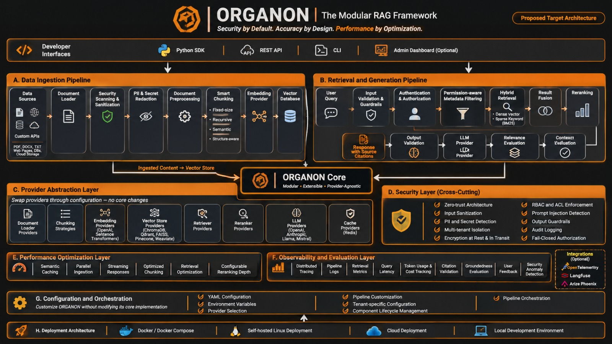

# ORGANON

### The Modular RAG Framework

🚧 **UNDER DEVELOPMENT**

An open-source, modular, and provider-agnostic framework for building Retrieval-Augmented Generation (RAG) systems.

---

## Architecture

## About

ORGANON is an open-source framework designed to provide a flexible and extensible foundation for building Retrieval-Augmented Generation (RAG) systems.

It brings document processing, embedding models, vector databases, retrieval mechanisms, and Large Language Models (LLMs) together through a unified and configurable architecture.

With modular components and provider-agnostic integrations, ORGANON aims to give developers the freedom to design, customize, and deploy their own RAG infrastructure.

## Why ORGANON?

ORGANON comes from the Ancient Greek word *ὄργανον (órganon)*, meaning **instrument or tool**.

Inspired by the idea of knowledge as a tool, ORGANON aims to give developers the building blocks and freedom to create their own RAG systems.

## Core Principles

- **Modular Architecture** — Independently configurable and replaceable components.
- **Provider Agnostic** — Freedom to integrate different AI and infrastructure providers.
- **Security First** — Designed around data protection, access control, and isolation.
- **Extensible** — Built to support custom providers and integrations.
- **Self-Hosted** — Designed for deployment on infrastructure you control.

## Planned Capabilities

- Document ingestion and processing
- Multiple chunking strategies
- Configurable embedding providers
- Vector database integrations
- Hybrid retrieval and reranking
- LLM provider integrations
- Secure, permission-aware retrieval
- Evaluation and observability
- Caching and performance optimization
- REST API and Python SDK
- Docker-based deployment

## Development Status

ORGANON is currently under active development. Its architecture and components are being implemented incrementally, with an emphasis on modularity, reliability, security, and production readiness.

## Project Philosophy

**Build your RAG. Your architecture. Your choice.**

---

**ORGANON**  
Open-source RAG infrastructure for developers.

